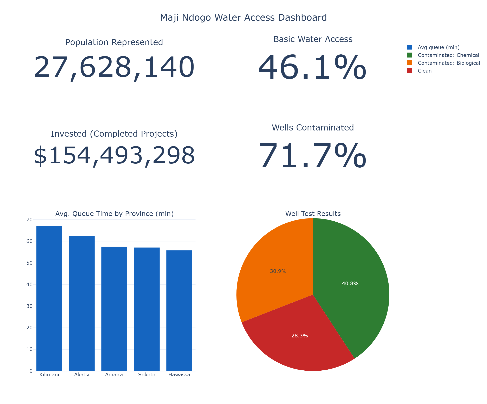
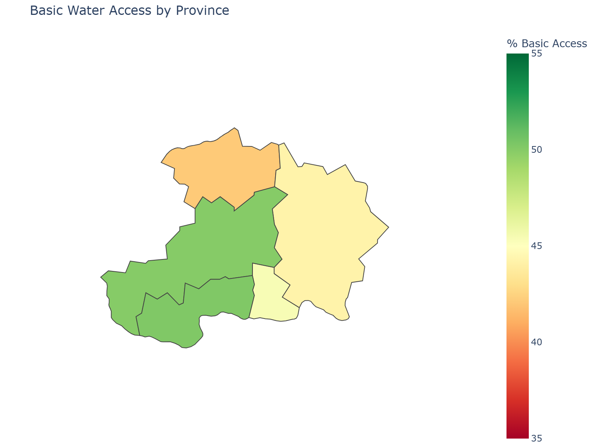
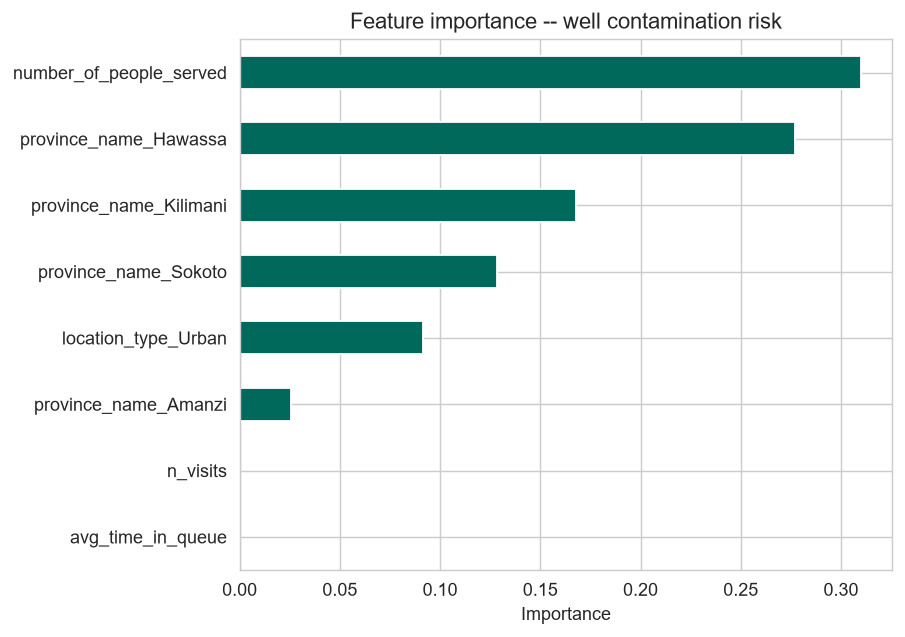

# 💧 Maji Ndogo Water Access Analytics

**SQL + Python analysis of water infrastructure equity across a country of 27.6 million people — data cleaning, EDA, choropleth mapping, and a well-contamination risk model**

> Interactive dashboard: [dashboard/water_access_dashboard.html](dashboard/water_access_dashboard.html)

---

## Problem

Maji Ndogo's water ministry has years of operational data — water source inventories, site visits, well-quality tests, an infrastructure improvement program, and (historically) crime records — spread across four inconsistent workbook exports of the same tracking system. No single export was complete. This project reconciles that data into one clean source, then answers the questions a ministry actually needs answered: who has basic water access and who doesn't, where is the gap worst, how contaminated is the groundwater, and how effectively has the $154.5M improvement program been spent.

**Research questions:**
- What share of the population has *basic* water access, by the WHO/JMP standard, and where is it worst?
- Which provinces have the longest queues, and does queue time alone explain the access gap?
- How contaminated is well water, and can contamination risk be predicted from non-lab features?
- How much has the improvement program invested, and how efficiently, by vendor and improvement type?

---

## Dataset

Source: four separate Excel exports of the same water-services tracking system (~39,650 water sources, 60,146 site visits, 17,383 well-quality tests, 25,398 completed infrastructure projects, 95 vendors, and historical crime records), covering 5 provinces and 31 towns.

**None of the four exports was individually complete** — each was missing different columns or entire tables that another export had. [`notebooks/01_data_cleaning.ipynb`](notebooks/01_data_cleaning.ipynb) documents the full column-level reconciliation: which export supplied which field, and why (e.g. one export turned out to be an earlier snapshot of the same records, not a competing version of the truth).

| Table | Rows | What it holds |
|---|---|---|
| `water_source` | 39,650 | Source type (tap/well/shared tap/river), people served |
| `location` | 39,650 | Province, town, urban/rural, address |
| `visits` | 60,146 | Site-visit records, queue time, timestamp (2021–2023) |
| `well_pollution` | 17,383 | Lab test results for every well (Clean / Chemical / Biological) |
| `project_progress` | 25,398 | Improvement projects, status, cost, vendor, dates |
| `vendors` | 95 | Infrastructure contractors |
| `water_source_related_crime` | 77,226 | Historical incidents near sources (2010–2020) |

---

## Methods

| Layer | What it does | Files |
|---|---|---|
| **Cleaning** | Reconcile 4 partial exports into one complete, validated dataset | [`notebooks/01_data_cleaning.ipynb`](notebooks/01_data_cleaning.ipynb) |
| **SQL** | Normalized SQLite schema + validation queries + 10 business-question queries (window functions, ranking, CTEs) | [`sql/`](sql/) |
| **EDA** | Access-level classification, province choropleth, queue analysis, contamination rates, vendor cost efficiency | [`notebooks/02_exploratory_analysis.ipynb`](notebooks/02_exploratory_analysis.ipynb) |
| **ML** | Well-contamination risk classification (Logistic Regression + Random Forest) | [`notebooks/03_machine_learning.ipynb`](notebooks/03_machine_learning.ipynb) |
| **Dashboard** | Self-contained interactive HTML dashboard | [`dashboard/water_access_dashboard.html`](dashboard/water_access_dashboard.html) |

---

## Results

- **Only 46.1% of the represented population (27.6M) has basic water access.** 31.6% have an improved source but queue 30+ minutes on average; 13.8% rely on broken in-home taps; 8.6% still depend on unimproved river water.
- **Sokoto is the worst-served province (42.1% basic access); Akatsi the best (50.2%)** — but even the best province leaves roughly half its population underserved. This is a system-wide gap, not one province's problem.
- **71.7% of tested wells are contaminated** (40.8% chemically, 30.9% biologically) — a health issue independent of queue-time access.
- **The improvement program has invested $154.5M across 25,398 completed projects**, but cost-per-project efficiency varies more than 8x between vendors doing the same type of work.
- **Women carry 69% of average queue time.** Historical crime data near water sources (2010–2020, a period that does not overlap with the 2021–2023 visit records — see the cleaning notebook for why these two facts are reported separately rather than causally linked) shows 64.4% of recorded victims are female.




---

## Machine Learning

**Well contamination risk classification** — every well is already lab-tested, so this isn't a "predict the unknown" problem; it's a *risk-ranking* tool for prioritizing future drilling/inspection budget by location. Leakage was checked explicitly: the lab measurements that produce the contamination label (`pollutant_ppm`, `biological`, `description`) are excluded from the features. Only pre-test knowledge is used — province, urban/rural, population served, and usage intensity.

A real methodology bug was caught and fixed during evaluation: the source data is sorted by province prefix, so an un-shuffled 5-fold cross-validation produced wildly unstable, often sub-random AUC (as low as 0.20) purely from that ordering artifact. Using a properly shuffled `StratifiedKFold` fixed it — **both models land at a stable ROC-AUC ≈ 0.66** (std ≈ 0.01 across folds), moderate but genuine signal, dominated by `number_of_people_served` and province. Usage intensity (visit count, queue time) contributes almost nothing — contamination looks tied to *where* a well is, not how heavily it's used.

**The AUC doesn't tell the whole story:** at the default classification threshold, the model's recall on the minority "Clean" class is just 1% — it's effectively always predicting "Contaminated." The model *ranks* risk well but isn't a usable classifier out of the box; a real deployment would need threshold tuning. Full discussion in [`notebooks/03_machine_learning.ipynb`](notebooks/03_machine_learning.ipynb).



---

## Installation

```bash
git clone https://github.com/Valerie-komen/Maji-Ndogo-Water-Access-Analytics.git
cd Maji-Ndogo-Water-Access-Analytics
pip install -r requirements.txt
```

## Reproducibility

1. **Data cleaning:** [`notebooks/01_data_cleaning.ipynb`](notebooks/01_data_cleaning.ipynb) reconciles the raw exports (not committed to this repo — see note below) into `data/*.csv` + `data/water_services.db`.
2. **SQL:** [`sql/database_creation.sql`](sql/database_creation.sql) → [`sql/cleaning_queries.sql`](sql/cleaning_queries.sql) → [`sql/analysis_queries.sql`](sql/analysis_queries.sql).
3. **EDA:** [`notebooks/02_exploratory_analysis.ipynb`](notebooks/02_exploratory_analysis.ipynb).
4. **ML:** [`notebooks/03_machine_learning.ipynb`](notebooks/03_machine_learning.ipynb).
5. **Dashboard:** open [`dashboard/water_access_dashboard.html`](dashboard/water_access_dashboard.html) directly in a browser.

**Note on raw data:** the four original Excel exports (~20MB combined) are ALX coursework materials and aren't committed here to keep the repo lean — `data/` contains the fully reconciled, analysis-ready output instead. The full reconciliation logic (which export supplied which field, and why) is documented in notebook 01.

All notebook outputs in this repository are real, executed results.

---

## Repository Structure

```
Maji-Ndogo-Water-Access-Analytics/
├── README.md
├── requirements.txt
├── data/                  # reconciled CSVs, SQLite db, province GeoJSON
├── notebooks/
│   ├── 01_data_cleaning.ipynb
│   ├── 02_exploratory_analysis.ipynb
│   └── 03_machine_learning.ipynb
├── sql/
│   ├── database_creation.sql
│   ├── cleaning_queries.sql
│   └── analysis_queries.sql
├── dashboard/
│   └── water_access_dashboard.html
└── images/
```

---

## Limitations

- Crime data (2010–2020) and visit data (2021–2023) don't overlap in time — location-level patterns are reported, no causal time-based claim is made.
- The contamination model explains historical risk factors across provinces; it does not certify any individual untested well as safe.
- No data links the improvement program's specific projects back to the current `water_source` access-level snapshot, so the relationship between the $154.5M invested and the 46.1% current access figure is descriptive, not causal.

---

*Questions or feedback? Feel free to open an issue or connect with me on LinkedIn.*
